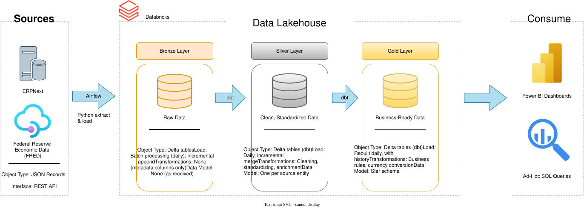

# ERP Analytics Pipeline

[](https://github.com/MahammadHajiyev2024/erp-analytics-pipeline/actions/workflows/ci.yml)

End-to-end analytics pipeline: ERPNext REST API → Airflow → Databricks medallion lakehouse → dbt → Power BI.

> **Status:** Work in progress. Phases 0 to 9 are complete: requirements, architecture, environment setup, continuous integration, the ERPNext source system, two years of verified historical data, a business activity simulator that keeps the company trading daily, a Databricks lakehouse, the extraction/bronze layer, and Airflow orchestration. Phase 10 is fully done: dbt's Silver layer (6 staging models) and Gold layer (4 dimensions, 4 facts — the constellation schema). Phase 11, Power BI reporting, is underway: the semantic model (10 relationships, 14 DAX measures, row-level security for two sales territories) and all 5 report pages (Overview, Managing Director, Sales Manager, Inventory Manager, Finance Manager) are built. Still to come: screenshots, a demo GIF, and Phase 12.

## Overview

Maple Home & Gift Ltd is a UK-based online wholesaler of home décor and giftware. It's a
company I built for this project, based on a real UK online retailer whose anonymized
transactions make up the UCI Online Retail II dataset. That sales history runs through a
self-hosted ERPNext instance as Maple's books, enriched with macroeconomic data from the FRED
API. Maple keeps its books in British pounds (GBP) and reports in US dollars (USD) to its
US parent company, using daily FRED exchange rates, like most multinationals do.

From there, a custom ELT pipeline pulls business data out of ERPNext through its REST API,
loads it into a Databricks lakehouse, and transforms it through bronze, silver, and gold
layers with dbt. The gold layer feeds Power BI dashboards. Everything runs in Docker and is
orchestrated by Airflow, from the daily business simulation through to the dashboard refresh,
so the whole environment can be rebuilt with one command.

*Maple Home & Gift and its parent company are fictional, and all activity after the historical
period is simulated. The sales history itself is real, anonymized data (UCI Online Retail II),
with dates shifted forward; costs are simulated.*

## Stakeholders, KPIs, and Scope

The dashboards serve four stakeholders: the Managing Director, Sales Manager, Inventory Manager,
and Finance Manager. Key KPIs include net revenue (in GBP and USD), gross margin, year-over-year
growth, average order value, days of stock cover, return rate, and accounts receivable.

Data is refreshed in a daily batch. Real-time data, forecasting, and full tax compliance are out of scope.

Detailed questions, KPI definitions, assumptions, scope, and constraints are in
[requirements](docs/requirements.md).


## Architecture

The design follows **Separation of Concerns**: each layer and component has a single responsibility.



The reasoning behind each choice is in [design decisions](docs/design-decisions.md).

Naming rules for tables, columns, and code are in [conventions](docs/conventions.md).

The star schema, with the grain of each table, is in [data model](docs/data-model.md).

## Project Structure

```
bootstrap/    One-time load of historical data into ERPNext
simulator/    Generates daily business activity in ERPNext
extractors/   Pull data from the ERPNext and FRED APIs
loaders/      Write raw data to the Databricks bronze layer
tests/        Unit tests for the Python code
docs/         Architecture and design decisions
common/       Code shared by several parts, such as the ERPNext API client
```

## Getting Started

Requirements: [Git](https://git-scm.com/), [uv](https://docs.astral.sh/uv/), and, from Phase 4
onward, [Docker Desktop](https://www.docker.com/products/docker-desktop/).

```bash
git clone https://github.com/MahammadHajiyev2024/erp-analytics-pipeline.git
cd erp-analytics-pipeline
uv sync
cp .env.example .env   # then fill in your own values (on Windows: Copy-Item .env.example .env)
```

To start ERPNext (the first start creates the site, which takes a few minutes):

```bash
docker compose -f docker/erpnext/compose.yaml --env-file .env up -d
```

ERPNext then runs at http://localhost:8080. Log in as `Administrator` with the
`ERPNEXT_ADMIN_PASSWORD` from your `.env`. To stop it:

```bash
docker compose -f docker/erpnext/compose.yaml --env-file .env stop
```
First-time setup (company, fiscal year, and the pipeline's read-only user)
is described in [ERPNext setup](docs/erpnext-setup.md).

## Notable Engineering Decisions

Full reasoning for every decision is in [`docs/design-decisions.md`](docs/design-decisions.md)
(ADRs). A few worth a closer look:

- **ADR 23 — CI runs as a second, deliberately under-privileged Databricks user, not the
  pipeline's own account.** Least privilege in practice: a leaked CI secret can touch a
  throwaway schema, not real data. Getting there took two false starts (a new "scoped token"
  feature that a required connector backend silently couldn't read) before finding the actual
  cause — documented including the dead ends, not just the fix.
- **ADR 17 — Keyset pagination with a watermark overlap for incremental extraction.** Measured,
  not assumed: offset pagination silently skips rows when a background job rewrites old records
  mid-page; paging by `modified` instead of the indexed `name` column measured ~11s vs. ~0.1s per
  page on 1.5M rows.
- **ADR 18 — Investigated a data-correctness red flag and ruled it out with evidence.** ERPNext
  was silently rewriting old stock records in the background. Rather than assume it was harmless
  or over-correct, compared all 69,965 affected rows and confirmed the field revenue math
  depends on never changed, then added a dbt test so a real future divergence gets caught.
- **ADR 22 — Found a real dependency conflict via a failed `uv lock`, not a guess**, and
  restructured the project (dbt in its own `uv` project) rather than force an unsafe downgrade.

## Roadmap

- [x] Phase 0: Requirements analysis
- [x] Phase 1: Architecture and design
- [x] Phase 2: Environment setup
- [x] Phase 3: Continuous integration
- [x] Phase 4: Source system (ERPNext)
- [x] Phase 5: Bootstrap historical data
- [x] Phase 6: Business activity simulator
- [x] Phase 7: Databricks lakehouse setup
- [x] Phase 8: Extraction and bronze layer
- [x] Phase 9: Airflow orchestration
- [x] Phase 10: dbt silver and gold layers
- [ ] Phase 11: Power BI reporting (semantic model and report pages done; screenshots and demo GIF still to come)
- [ ] Phase 12: Documentation and demo

## Data Sources

- Historical sales data: [UCI Online Retail II](https://archive.ics.uci.edu/dataset/502/online+retail+ii) (CC BY 4.0)
- Exchange rates (GBP to USD): [FRED](https://fred.stlouisfed.org/), Federal Reserve Bank of St. Louis
