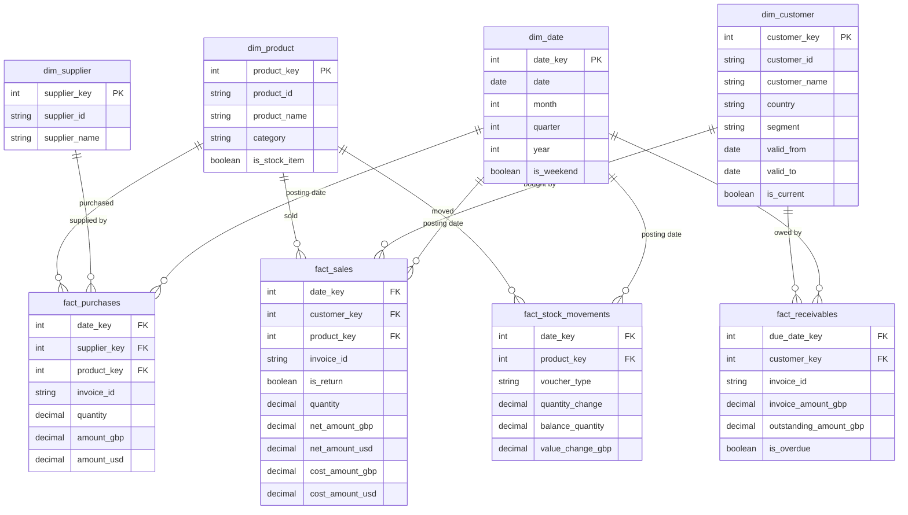

# Gold data model

The gold layer is a constellation schema: four fact tables sharing conformed dimensions.

## Tables and grain

| Table | Grain (one row per...) | Supports |
|---|---|---|
| `fact_sales` | Sales invoice line, including return lines | Revenue, margin, order value, returns, product pairs |
| `fact_purchases` | Purchase Invoice line | Purchasing and restocking |
| `fact_stock_movements` | Stock ledger entry | Stock levels, days of cover, slow-moving stock |
| `fact_receivables` | Sales invoice (current state) | Amounts owed and overdue |
| `dim_date` | Calendar day | All time-based analysis |
| `dim_customer` | Customer version (SCD Type 2) | Customer, country, and segment analysis |
| `dim_product` | Product (SCD Type 1) | Product and category analysis |
| `dim_supplier` | Supplier | Supplier analysis |

## Key decisions

- **History:** `dim_customer` tracks changes over time (SCD Type 2), so each sale keeps the
  customer's territory and segment at the time of sale. `dim_product` keeps only current values.
- **Revenue versus receivables:** revenue uses net amounts (excluding VAT); receivables use
  invoice totals, because customers owe the full amount.
- **Exchange rates:** amounts are converted to USD at the FRED rate on the posting date; on
  weekends and holidays, the most recent earlier rate is used.
- **Product pairs** are derived from `fact_sales`, using `invoice_id` to find products sold together.

## Source-to-target mapping (key columns)

| Target column | Source (ERPNext doctype and field) | Rule |
|---|---|---|
| `fact_sales.quantity` | Sales Invoice Item: `qty` | Submitted invoices only (`docstatus = 1`) |
| `fact_sales.net_amount_gbp` | Sales Invoice Item: `net_amount` | Excludes VAT |
| `fact_sales.is_return` | Sales Invoice: `is_return` | Return lines carry negative amounts |
| `fact_sales.cost_amount_gbp` | Sales Invoice Item: `qty` × `incoming_rate` | Cost at the time of sale |
| `fact_sales.net_amount_usd` | `net_amount` × FRED rate | Rate on the posting date, or the most recent earlier rate |
| `fact_stock_movements.quantity_change` | Stock Ledger Entry: `actual_qty` | Positive in, negative out |
| `fact_stock_movements.balance_quantity` | Stock Ledger Entry: `qty_after_transaction` | Stock after the movement |
| `fact_receivables.outstanding_amount_gbp` | Sales Invoice: `outstanding_amount` | Includes VAT |
| `fact_receivables.due_date_key` | Sales Invoice: `due_date` | |
| `dim_customer.country` | Customer: `territory` | |
| `dim_customer.segment` | Customer: `customer_group` | Set by the bootstrap's segment rule and kept current by the simulator's monthly reviews; gold copies it directly |
| `dim_product.category` | Item: `item_group` | Already an ERPNext Item Group, assigned by the bootstrap's category keyword rules; gold copies it directly |
| `dim_date` | Generated by dbt | Not from the source |
